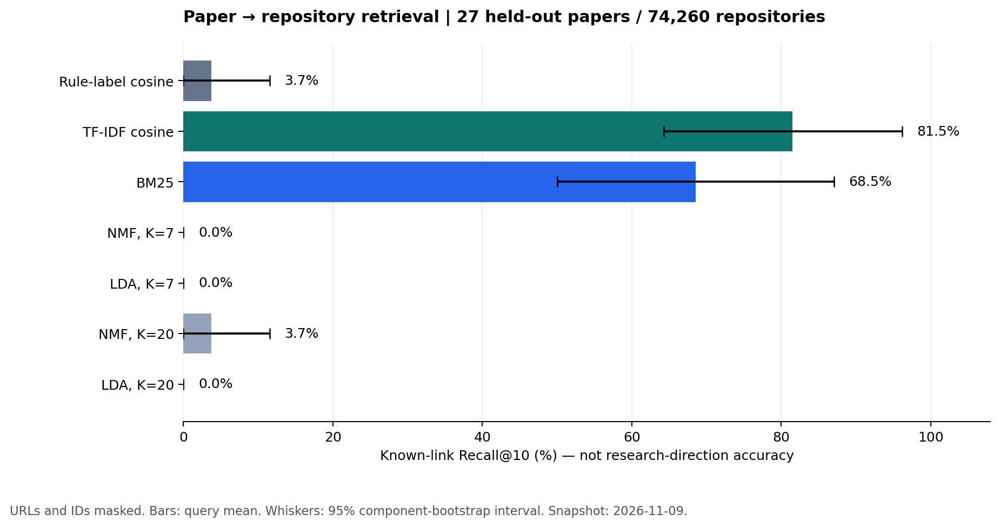

# OEVRYN 真实数据算法对比结果

**结论：先补证据与词汇关联检索，保留规则作可解释标签；目前没有依据把 NMF 或 LDA 整体替换进页面。** 全程没有使用大语言模型或 AI 标注作为答案。

该结论适用于本地已采集且通过现有筛选的快照。工程和计算校验通过；研究方向判断的准确性仍待人工专家评估。

## 数据与范围

原始输入 11,294 篇论文、90,123 条开源/动态记录。论文快照采集于 2026-11-09T22:33:52.202Z，来源快照生成于 2026-11-09T22:34:12.224Z。筛选去重后保留 81,332 条历史记录，其中 5,330 篇论文、74,260 个仓库、1,742 条动态。

主流窗口内为 5,197 篇论文、28,202 个最近更新仓库、1,639 条动态。主题实验训练 4,527 条、留出 1,112 条，按来源限制样本量，避免仓库数量主导训练。不是全量训练，也不是按真实领域比例抽样。

5,330 篇论文中 5,162 篇（96.8%）发表于 2026 年。仅 29 篇包含规则可识别的数据资源链接，5 篇链接到满足年龄/近期更新条件的 4 个仓库。未发现满足跨一年重复数据链接条件的候选。部分来源状态为 partial，不能把缺失当作不存在。

## 1. 主流主题：没有单一方法全面领先

统一口径采用各组训练文档的 TF-IDF 均值前十词，在同一留出集计算文档级 NPMI。另列模型原生词的结果，防止表示方式差异被掩盖。均值与范围来自三个初始化种子，范围不是置信区间。

| 方法 | 统一组均值 NPMI | 原生主题词 NPMI | 原生词多样性 | 种子匹配 Jaccard |
|---|---:|---:|---:|---:|
| 原规则（7 类） | 0.198 | 0.198 | 0.600 | 固定规则，不作优越性比较 |
| NMF (7) | 0.014 [0.014, 0.014] | 0.056 [0.056, 0.056] | 0.900 | 1.000 |
| LDA (7) | 0.138 [0.122, 0.159] | 0.206 [0.187, 0.238] | 0.710 | 0.589 |
| NMF (20) | 0.058 [0.055, 0.061] | 0.002 [0.002, 0.002] | 0.785 | 1.000 |
| LDA (20) | 0.039 [-0.014, 0.069] | 0.142 [0.129, 0.154] | 0.630 | 0.327 |

NPMI 衡量词语共现，不是方向正确率。规则类别允许重叠，学习模型取主导主题；两者的组粒度和拒绝机制不同。NMF 的结果中出现 DICOM/viewer/pacs 工具主题、radiology/business 新闻主题；LDA 也混合任务、器官、方法和通用论文词。这支持把主题模型用于候选发现，不支持自动把每个主题命名为一个研究方向。

当前规则的主流窗口覆盖率（至少命中一类）为：

- paper：4,385/5,197，84.4%。
- github：13,720/28,202，48.6%。
- news：284/1,639，17.3%。

学习模型通常会对非空词表文本分配主题；这种高覆盖不能与规则的命中率直接等同于召回率。

## 2. 论文—代码关联：词汇检索更值得优先加入

全部历史数据中有 113 篇论文存在显式代码关联；其中 27 篇落在留出组件，连接 28 个查询—仓库对，候选库为 74,260 个仓库。使用全部留出关联论文，不只限于上面的主题留出样本。输入网址、DOI 和 arXiv ID 已屏蔽。

| 方法 | 已知关联 Recall@10（95% 区间） | MRR |
|---|---:|---:|
| 原规则标签向量 | 3.7% [0.0%, 11.5%] | 0.006 |
| TF-IDF + cosine | 81.5% [64.3%, 96.2%] | 0.679 |
| BM25 | 68.5% [50.0%, 87.0%] | 0.502 |
| NMF (K=7) | 0.0% [0.0%, 0.0%] | 0.000 |
| LDA (K=7) | 0.0% [0.0%, 0.0%] | 0.001 |
| NMF (K=20) | 3.7% [0.0%, 11.5%] | 0.013 |
| LDA (K=20) | 0.0% [0.0%, 0.0%] | 0.004 |

TF-IDF−BM25 的配对 Recall@10 差为 13.0 个百分点，95% 区间 [-3.5, 28.8]。不能仅凭点估计宣布二者存在可靠优劣。置信区间按关联组件重采样，独立组件数为 26。

规则向量只是原有七类规则的检索适配，不是原系统的真实链接关联功能。本表说明它作为细粒度匹配表征不够用，不能解读为“原系统总体准确率只有 3.7%”。低维主题向量也缺少区分具体项目的细节。

零命中方法的 bootstrap 区间会退化为 [0,0]，不表示总体真实命中概率精确为零。

TF-IDF−BM25 的 MRR 差为 0.177，95% 区间 [0.058, 0.315]：当前小样本对 TF-IDF 的首个相关项目排序更有支持，仍需新数据复核。

进一步屏蔽已知仓库标题词后：

- TF-IDF + cosine：Recall@10 66.7% [48.1%, 84.6%]。
- BM25：Recall@10 57.4% [38.9%, 76.9%]。

银标准只包含已有显式关联，存在选择偏差和未标注相关项目；不能用这些结果宣称自动新关联的精确率。新闻没有可用的显式论文关联，相关检索指标为不可评估，不记作 0%。

## 3. 小众积累：主要瓶颈是证据，不是换聚类算法

下表列出候选经过每一项相同门槛的数量；各列并非逐步漏斗。规则为方向×问题×场景组合，模型为主导主题，候选粒度不同，数量不可作为质量排名。

| 候选方法 | 低占比候选 | 历史积累通过 | 逻辑词法线索通过 | 长期数据链接通过 | 成熟关联代码通过 | 全部通过 |
|---|---:|---:|---:|---:|---:|---:|
| 原规则标签向量 | 303 | 10 | 171 | 0 | 2 | 0 |
| NMF (K=7) | 6 | 3 | 5 | 0 | 2 | 0 |
| NMF (K=20) | 17 | 6 | 13 | 0 | 1 | 0 |
| LDA (K=7) | 2 | 0 | 2 | 0 | 1 | 0 |
| LDA (K=20) | 17 | 7 | 13 | 0 | 3 | 0 |

全部算法都没有通过长期数据证据门槛。原规则 303 个候选中，单独去掉任意一项门槛，完全合格数仍为 0，说明不是简单下调一个阈值就能解决。NMF/LDA 的部分组在去掉数据条件后可通过其他词法门槛，但这不能证明它们具备长期数据积累。

## 4. 排序对规则参数的敏感性

保持方向词典不变，观察主流阈值与来源权重变化：

| 来源权重 | 阈值 3% | 阈值 5% | 阈值 7% |
|---|---|---|---|
| equal | 分割与结构解析、检测与辅助诊断、定量影像与预后预测、基础模型与视觉语言、重建与图像增强 | 分割与结构解析、检测与辅助诊断、定量影像与预后预测、基础模型与视觉语言、重建与图像增强 | 分割与结构解析、检测与辅助诊断、定量影像与预后预测、基础模型与视觉语言 |
| paperHalf | 分割与结构解析、检测与辅助诊断、定量影像与预后预测、基础模型与视觉语言、重建与图像增强、配准与运动分析 | 分割与结构解析、检测与辅助诊断、定量影像与预后预测、基础模型与视觉语言、重建与图像增强 | 分割与结构解析、检测与辅助诊断、定量影像与预后预测、基础模型与视觉语言、重建与图像增强 |
| paperOnly | 分割与结构解析、检测与辅助诊断、定量影像与预后预测、基础模型与视觉语言、重建与图像增强、配准与运动分析、图像合成与跨模态转换 | 分割与结构解析、检测与辅助诊断、定量影像与预后预测、基础模型与视觉语言、重建与图像增强、配准与运动分析 | 分割与结构解析、检测与辅助诊断、定量影像与预后预测、基础模型与视觉语言、重建与图像增强 |
| noNews | 分割与结构解析、检测与辅助诊断、定量影像与预后预测、基础模型与视觉语言、重建与图像增强、配准与运动分析 | 分割与结构解析、检测与辅助诊断、定量影像与预后预测、基础模型与视觉语言、重建与图像增强 | 分割与结构解析、检测与辅助诊断、定量影像与预后预测、基础模型与视觉语言、重建与图像增强 |

这不是寻找最佳参数；它揭示手设阈值和来源权重会改变页面结论。论文、代码和动态不是三个相互独立的研究力量投票。

## 采取的改进决策

1. **关联层优先引入 TF-IDF/BM25 候选检索，保留显式链接为可核实证据。** 先以离线建议方式运行；由人工审核新增关联，再评估 Precision@K。不要把文本相似直接写成“这篇论文的官方代码”。本轮两者的差异不足以确立唯一胜者。
2. **保留规则标签，NMF/LDA 只作为候选发现的并行实验。** 先补领域停用词、短语和来源样式处理，并建立独立人工标注，再检验是否改善。不能因为某个 NPMI 更高就直接替换页面。
3. **小众方向改成“证据充分 / 待补证据 / 有反证”的区分。** 当前大量缺失只能进入待补证据。补充至少数年的论文历史、数据集版本与 DOI、仓库 release/commit 时间序列、论文—数据—代码显式关系；再判断持续积累。暂不靠放宽阈值制造合格方向。
4. **问题、方法、场景继续保留原文出处。** TextRank 可作为证据句抽取候选，尚未实测；完整研究逻辑需要人工证据句/关系标注，不能用“包含四类词”冒充验证。
5. **建立新人工留出集后再作正式选型。** 主流方向评多标签 F1 和专家排序 nDCG；小众候选评 Precision@K、证据完整度及边界例；未知总体无法可靠估计真实小众召回率。两位评审分别标注并仲裁，禁止把历史 AI 草拟标签提升成金标准。

本轮提交的是实验基准与决策依据，没有替换生产页面的分析规则。

## 复查入口

- [完整设计、算法文献、指标定义与复现命令](README.md)
- [全部数值、词列表、样例和候选明细](results.json)
- [冻结参数](protocol.json)、[数据指纹与来源状态](manifest.json)、[数据划分与检索逐条得分](split.json)
- [待人工标注的原文任务](human-review.jsonl)；没有预填任何质量标签。

图中区间是小样本、组件级 bootstrap 区间，只反映当前已知关联测试的不确定性；它不是实际研究方向准确率。
